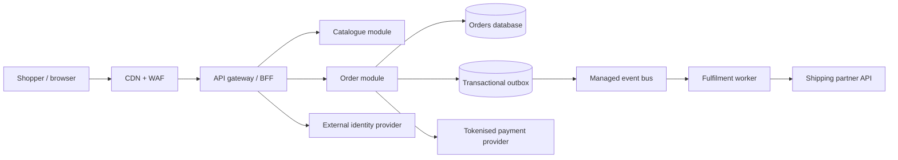

# Enterprise Solution Architecture | Fictional Commerce Platform

An **independent, public architecture reference** for a fictional mid-sized online retailer, **DemoMart**. It demonstrates requirements-to-design traceability, architectural trade-offs, security, resilience and delivery controls.

> Portfolio demonstration only. All scenarios, names, metrics, data and diagrams are invented. No employer or customer systems, documentation or confidential materials are used. This is a design reference, **not a deployed production service**.

## Architecture brief

DemoMart sells household goods online. It needs a reliable catalogue, checkout and order-tracking experience while integrating an outsourced payment provider and third-party shipping partner. Its existing single application is experiencing release bottlenecks during seasonal peaks.

**Design goals:** 99.9% monthly availability for customer checkout, p95 read latency under 300 ms excluding external networks, no storage of card numbers, traceable order events, controlled operational cost.

## Explore the portfolio

| Deliverable | Demonstrates |
| --- | --- |
| [Context and requirements](docs/context.md) | Stakeholder outcomes, scope, assumptions, constraints and traceability |
| [Architecture and diagrams](docs/architecture.md) | C4-style context/container views, synchronous and asynchronous flows |
| [Security and NFRs](docs/nfr-and-security.md) | Threat model, SLOs, RTO/RPO, data classification and controls |
| [Architecture decisions](docs/adrs/0001-modular-boundaries.md) | Decision rationale, options, consequences |
| [Data ownership ADR](docs/adrs/0002-order-events.md) | Eventual consistency and event contracts |
| [Delivery and verification](docs/delivery.md) | Incremental rollout, quality gates and operational ownership |

## Validate the architecture package

Requires Python 3.10+; no third-party packages.

```bash
python tools/verify_architecture.py
python -m unittest discover -s tests -v
```

The validator checks that key deliverables exist and that ADRs contain required decision headings. CI runs it on every push.

## Architecture at a glance



## Next engineering increments

1. Create a lightweight API contract and mock-order service.
2. Provision an isolated sandbox via infrastructure as code.
3. Measure latency and failure recovery in a controlled load test.
4. Record observed results in an evidence table; do not present design targets as measured results.

## License

MIT. Contributions and corrections are welcome.
