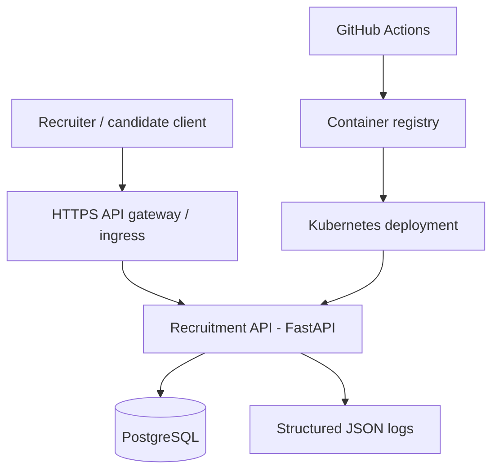

# Civic Talent Platform

A fictional recruitment workflow reference architecture built entirely with original sample code and synthetic data.

The runnable core is a Python FastAPI service backed by PostgreSQL, with an in-memory SQLite option for tests and local evaluation. The remaining folders show how this service could be packaged and operated on a cloud platform. They are learning blueprints, **not evidence of production deployment**.

## Architecture



## Quick start

Requires Docker Compose:

```bash
docker compose up --build
curl http://localhost:8000/health/live
curl http://localhost:8000/health/ready
```

Open `http://localhost:8000/docs` for interactive API documentation. Set an API key other than the illustrative dev key when deploying anywhere shared.

```bash
curl -X POST http://localhost:8000/v1/candidates \
  -H 'X-API-Key: local-development-only' -H 'Content-Type: application/json' \
  -d '{"name":"Example Candidate","email":"candidate@example.com","skills":["Python","SQL"]}'
curl -X POST http://localhost:8000/v1/vacancies \
  -H 'X-API-Key: local-development-only' -H 'Content-Type: application/json' \
  -d '{"title":"Solution Architect","department":"Digital Services"}'
```

The API supports candidate creation/listing, vacancy creation/listing, applications and guarded status transitions. Synthetic sample identities only.

## Test locally

```bash
python -m pip install -r requirements-dev.txt
pytest -q
```

## Technology coverage

| Job requirement | Where to learn it | What is actually implemented |
|---|---|---|
| Python / REST APIs | `app/main.py` | Working API, validation, OpenAPI docs |
| SQL / relational modelling | `app/models.py` | Candidates, vacancies, applications, constraints |
| Docker | `Dockerfile`, `compose.yaml` | Multi-service local stack |
| Kubernetes | `deploy/k8s/` | Deployment, service, probes, resource limits |
| Terraform / AWS | `infra/aws/` | Illustrative VPC, ECS/Fargate and managed RDS plan; not applied |
| CI/CD | `.github/workflows/ci.yml` | Automated tests and Docker build checks |
| Security | `app/main.py`, `docs/security.md` | API-key demo auth, input validation and security checklist |
| Observability | `app/main.py`, `docs/operations.md` | Correlation IDs, JSON logs and health checks |
| GCP / IaaS / PaaS / SaaS | `docs/cloud-options.md` | Design comparison, not deployed |
| Java / JavaScript | `examples/client.js`, `examples/Client.java` | Illustrative API clients |

## Learning route

1. Read [`docs/architecture.md`](docs/architecture.md) for design decisions and data flow.
2. Run Docker Compose and create sample records using `/docs`.
3. Read [`docs/security.md`](docs/security.md): learn why this is **not production-grade authentication**.
4. Study Kubernetes manifests, then Terraform's alternate AWS deployment topology.
5. Read [`docs/interview-guide.md`](docs/interview-guide.md) and practise explaining trade-offs honestly.

## Scope and limitations

- Demo only; do not enter personal data or deploy to the internet without an authentication, privacy, encryption, migrations, backup and threat-modelling review.
- Tests run using SQLite, whereas deployment uses PostgreSQL. Add PostgreSQL integration tests before production.
- Kubernetes and Terraform are **alternative deployment reference paths**; no claim that the Kubernetes manifests match ECS resources.
- No resume screening, automated hiring decisions, real identities, emails or external integrations.

License: MIT. See `LICENSE`.
