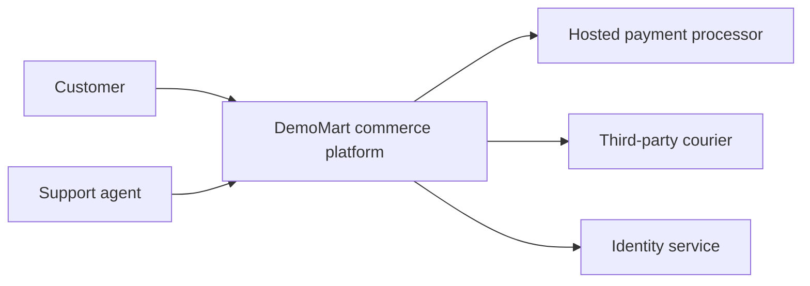
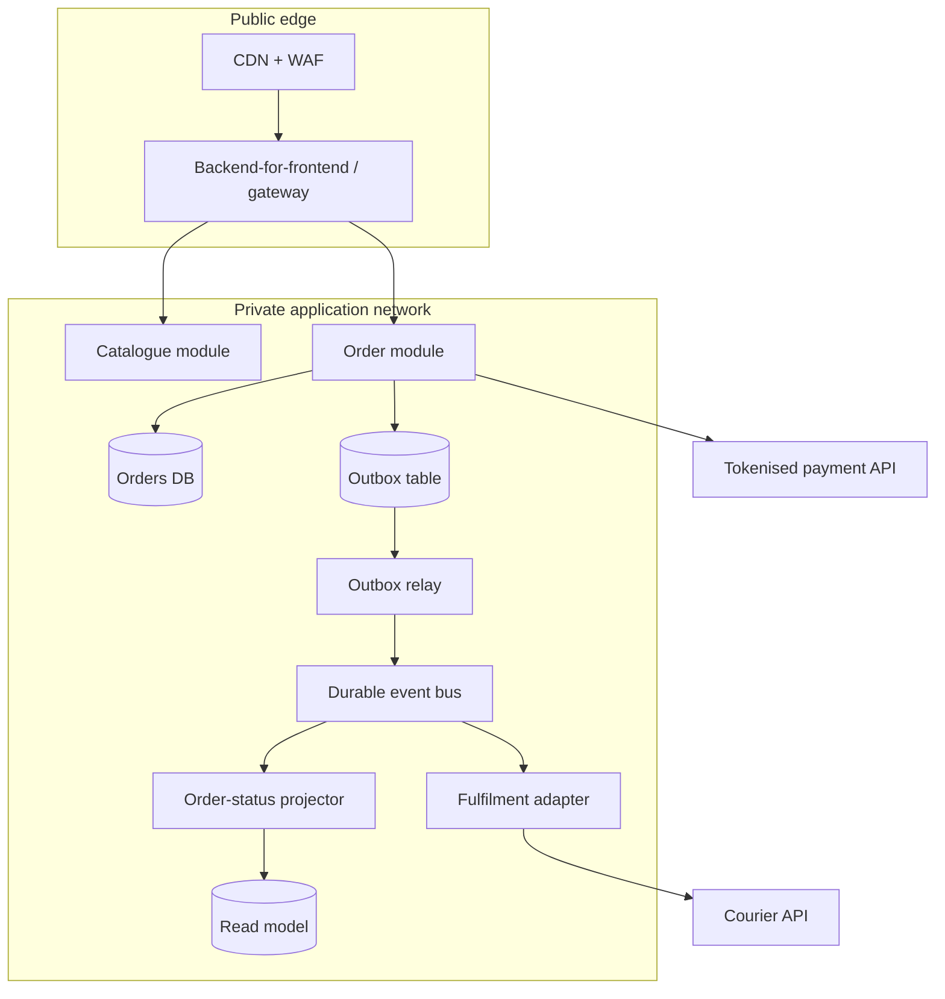
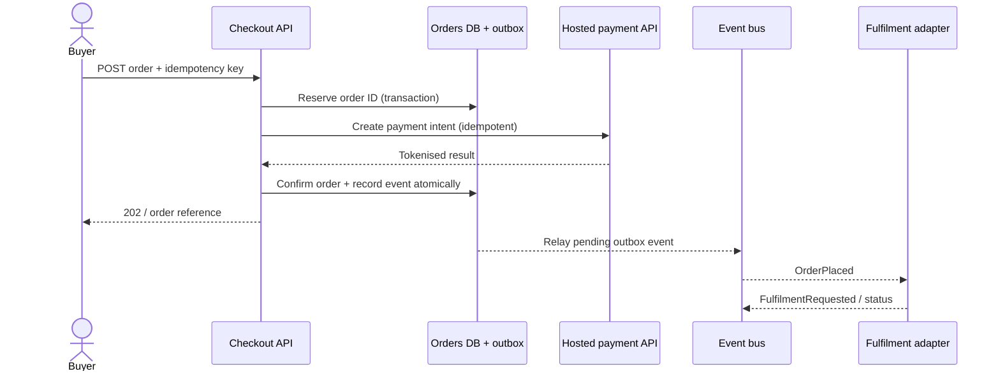

# Proposed solution architecture

This is a **logical design**, intentionally cloud-provider neutral. Vendor choice should follow requirements, pricing, support model and operational maturity.

## System context

## Logical containers

## Order lifecycle

### Failure and consistency semantics

- **Order DB:** source of truth for order state.
- **Outbox:** avoids committing an order without recording the event to publish.
- **Bus:** assume at-least-once delivery; consumers must deduplicate by event ID.
- **Payment:** use provider idempotency keys and reconcile ambiguous timeout outcomes; never assume a timeout equals a failed charge.
- **Fulfilment:** retries with backoff, dead-letter review, poison-message handling and an explicit reconciliation process.
- **Read projection:** eventually consistent; customer UI displays “processing” when appropriate.

## Trust boundaries

Public web traffic crosses WAF and authentication boundaries. Internal components authenticate using short-lived workload identities and only access required services. Payment card entry occurs on the hosted provider surface; logs must redact personal identifiers and tokens.

## Deployment view

Deploy gateway and stateless components across at least two availability zones, use managed encrypted storage and a managed queue, and use separate development/staging/production accounts or subscriptions. Set resource quotas, autoscaling bounds and cost alerts.

## Observability

Trace a request using a correlation ID across API, outbox, event relay and fulfilment. Track checkout success, queue age, consumer failures, time-to-reconcile and payment ambiguity rates. Audit administrative access separately.
